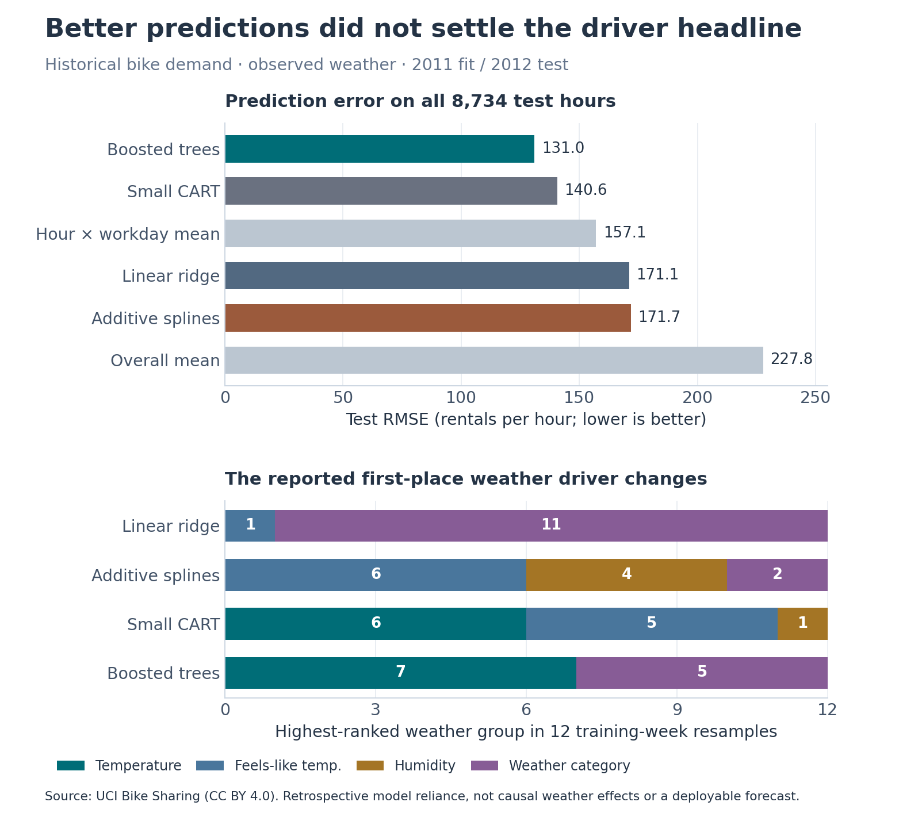
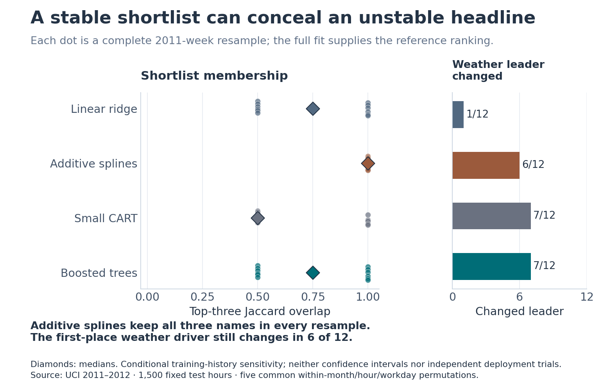
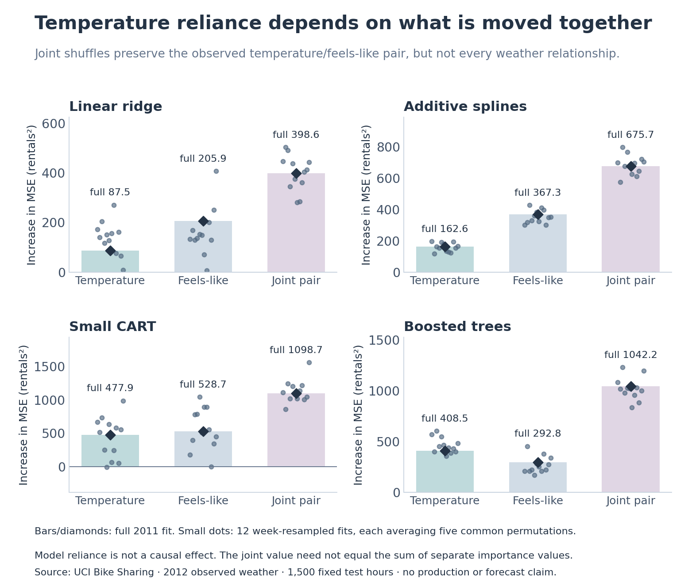

# A stable driver shortlist can still produce an unstable business claim

The boosted model reduced observed-weather test MSE by **30.4%** against an hour-by-workday mean, but its highest-ranked weather variable changed in **7 of 12** training-week resamples. Additive splines kept the same top-three set in every resample while changing the weather leader in **6 of 12**, and predicted worse than the simple baseline.

For an operations report, show predictive error and first-place frequency together. Grouping temperature with feels-like temperature resolved one ranking ambiguity in three of four model families here. These are historical model-reliance results under a specified shuffle. They do not estimate causal weather effects or establish a next-day forecast.



## The decision and measured tradeoff

An analyst wants to describe the weather variable most important to a demand model. This study asks whether that headline survives a different sample of historical training weeks. It compares four declared model families, rather than choosing a test-year explanation that looks persuasive.

All full-training models use 2011 and are evaluated on the same **8,734 hours in 2012**. Model selection uses three forward folds within 2011. Negative raw count predictions are retained and clipped at zero only for the predeclared evaluation rule.

| Full-training model | Test MSE, rentals² | Test RMSE, rentals/hour | Changed weather leader, of 12 resamples |
|---|---:|---:|---:|
| Linear ridge | 29,286.3 | 171.1 | 1 |
| Additive splines | 29,489.3 | 171.7 | 6 |
| Small CART | 19,754.5 | 140.6 | 7 |
| Boosted trees | 17,165.8 | 131.0 | 7 |
| Hour × workday mean | 24,664.9 | 157.1 | — |
| Overall mean | 51,896.5 | 227.8 | — |

The linear family had a persistent individual weather leader but worse predictive error than the hour-by-workday mean. The additive model's stable shortlist did not imply a stable first-place claim. Report both failures alongside the improvement in boosted-tree error.



## Why the temperature grouping matters

The diagnostic uses 1,500 date-hour keys selected without labels, then five common permutations within month, hour and workday strata. Temperature and feels-like temperature are moved together for the joint comparison. Joint-temperature reliance ranked first among weather groups in all twelve additive, CART and boosted refits. It ranked first in five linear refits and second in seven.



Individual shuffles can break relationships between correlated measurements. Moving the pair together preserves its own observed relationship, but can still break relationships with other weather variables. The joint value need not equal the sum of individual values. Month, hour and workday themselves cannot change within these conditioning strata; their structural zero importance is not evidence of irrelevance. The 107 singleton evaluation rows remain unchanged. Zero and negative importances are preserved.

The twelve refits describe conditional training-history sensitivity. Their ranges and frequencies are not confidence intervals, independent deployment trials or evidence that one family is generally more interpretable.

## Optimization and independent evidence

- **Complete finite search:** 24 settings across 72 forward-validation fits, with all candidate predictions and losses retained. Winners: linear λ=0.01, additive λ=0.1, CART depth 6/minimum leaf 20, and boosting 7 leaves/learning rate 0.1/L2=1. Boosting uses 120 fixed iterations, not a convergence claim.
- **Frozen evaluation:** 52 full/week-resampled variants are stored as readable transforms, coefficients and tree nodes. [The freeze](results/freeze.json) was committed at `ef81e565ad311ffc1097d936baac878d7895ee83` before test inference. Hyperparameters were not retuned in the resamples.
- **Convex fitting checks:** 56 ridge objective, gradient and positive-definite penalized feature-Hessian certificates. The largest independent gradient was 3.27e-12. This supports each fixed-design fitting objective, not globally optimal generalization.
- **Independent arithmetic:** all 105,480 validation predictions, 471,636 full-test predictions, 4,290,000 permutation predictions, 2,860 repeat losses, 572 averaged importances and 52 rank rows reconcile. Separate scalar inference was checked at 5,720 fixed cases; that inference check is a sample.
- **Reproduction:** eight scientific contracts and a fresh Windows replay pass at 1e-7 absolute/1e-9 relative tolerance. GitHub repeats the full experiment on ready reviews and main; draft work does not run an incomplete release candidate.

The first independent pre-test check exposed a one-ulp parser discrepancy at a spline boundary. Round-trip source parsing corrected it before any 2012 scoring, and all fits were regenerated. [The correction record](results/corrections/roundtrip_ingestion.json) and original revision history remain available. Figure-value bindings are checked independently; all three figures were visually reviewed. No comparison tolerance was relaxed.

## Source and limits

Hadi Fanaee-T's [UCI Bike Sharing dataset](https://archive.ics.uci.edu/dataset/275/bike+sharing+dataset), DOI [10.24432/C5W894](https://doi.org/10.24432/C5W894), supplies 2011–2012 Capital Bikeshare hourly aggregate counts and observed weather under CC BY 4.0. [Every original value and calendar/target identity was reconciled](results/INDEPENDENT_SOURCE_CHECK.json). The CSV has **17,379 rows**, rather than the landing page's 17,389; **165 absent hours** remain absent, not zero demand. There are no individual rider records in this source package.

This is one historical system, one protected temporal evaluation, and a bounded set of week perturbations. Observed weather, changing demand between years and the conditioning strata limit transfer. The work establishes no causal policy effect, realized savings, production adoption or new explanation algorithm. [Method context and rights](SOURCES.md) distinguish this comparison from established model-class-reliance research.

## Reproduce

Use Python 3.10 and the pinned requirements. Source retrieval checks the published archive/member/panel hashes and preserves the original retrieval metadata; the archive stays outside Git.

```sh
python -m pip install -r requirements.txt
python src/fetch.py
python -m unittest discover -s tests -v
python src/check_reproduction.py
```

The replay refits every declared model in a temporary workspace, regenerates prediction and explanation exports, independently checks results and compares new numerical outputs with the recorded study. Figure input hashes are checked within each replay; harmless platform-dependent serialization is not substituted for numerical comparison.

This is an independent, AI-assisted research example. Manuscript drafts and source papers remain private. No paid compute, model service, fabricated activity or business-impact claim is part of the study.
